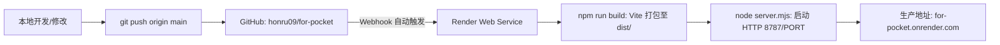
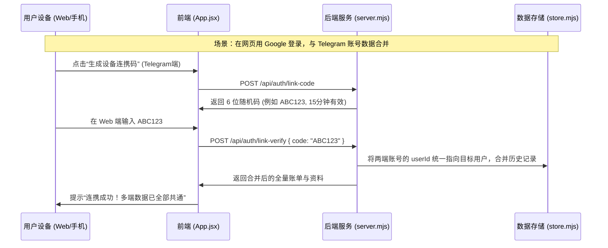

# for. Pocket 项目部署与接手计划书 (Deployment & Handoff Playbook)

> **致接手本项目的下一位 AI Agent / 工程师**：  
> 本计划书包含 `for.` (for-pocket) 治愈系记账 Mini App 的**全局架构、GitHub 仓库流转、云端 Render 自动化部署、Telegram Bot 联调、Google 跨端连携、Life360 模式好友圈体系及常见排障避坑指南**。阅读本指南后，你可以无缝接盘、本地调试、迭代功能并完成生产发布。

---

## 一、项目速览与技术架构

### 1.1 项目基本信息
- **项目名称**：`for.` (for-pocket)
- **生产环境访问地址**：`https://for-pocket.onrender.com`
- **Telegram Bot**：`@for_pocket_bot`（Web App 入口：`https://t.me/for_pocket_bot/app`）
- **GitHub 仓库**：`https://github.com/honru09/for-pocket.git`
- **默认生产分支**：`main`

### 1.2 技术选型一览
- **前端视图**：React 19 配合 Telegram 官方 UI 库 `@telegram-apps/telegram-ui`。
- **构建工具**：Vite 8（支持现代 ES Module 与超轻量打包，生产打包产物在 `dist/`）。
- **后端服务**：Node.js 原生 HTTP 服务（`server.mjs`），无需笨重框架，集成了静态文件托管、RESTful API、安全校验与速率限制。
- **存储机制**：轻量级持久化 JSON 存储（`store.mjs`），配备基于 Promise 的队列互斥写入锁与原子临时文件（`.tmp`）替换机制，保证高并发数据零丢失、防损坏。
- **视觉风格**：极简日式纸质质感（底色 `#f8f7f1`、文字 `#333a30`、鼠尾草绿 `#e6ebd7`），Liia 按键温润奶白（`#fbf8f1`），手绘 SVG 图标，全站 450~850ms 缓慢高帧纸张物理缓动（`cubic-bezier(.22, 1, .36, 1)`）。

---

## 二、GitHub 仓库与代码流转流程

### 2.1 本地工作环境
- **本地工作目录**：`c:\Users\wangxr\Documents\Codex\2026-10-09\wo-x\outputs\for-pocket`
- **远程分支映射**：
  ```bash
  origin  https://github.com/honru09/for-pocket.git (fetch)
  origin  https://github.com/honru09/for-pocket.git (push)
  ```

### 2.2 标准 Git 提交流程
每次代码编写或修复后，严格按照如下步骤同步至云端：

```bash
# 1. 运行自动化测试（必须全部通过）
npm test

# 2. 运行前端构建校验（确保 Vite 打包无语法或依赖错误）
npm run build

# 3. 查看修改文件状态
git status

# 4. 暂存所有修改
git add .

# 5. 提交变更（按照 Conventional Commits 规范清晰描述）
git commit -m "feat: [功能说明]"

# 6. 推送至 GitHub main 分支（将自动触发 Render 云端部署）
git push origin main
```

> [!WARNING]
> **Windows 环境避坑提示**：
> 在 Windows PowerShell 环境下执行命令时，**不要**编写超长多行的 heredoc 命令行字符串（会导致系统报 `The filename or extension is too long` 错误）。修改代码请优先使用精准的代码替换工具（如 `replace_file_content`）或小型脚本。

---

## 三、云端部署（Render Cloud Deployment）全流程

本项目后端与前端一体化部署在 **Render**（[https://render.com](https://render.com)）平台上。

### 3.1 部署架构流程


### 3.2 Render 控制台新建与配置步骤（若是新建服务）
若日后需要迁移或新建 Render 服务，请按以下参数创建：
1. 登录 Render 控制台，点击 **New +** -> **Web Service**。
2. 连接 GitHub 仓库：选择 `honru09/for-pocket`。
3. **基本参数配置**：
   - **Name**：`for-pocket`
   - **Region**：`Singapore` 或 `Oregon`（推荐新加坡或离用户近的地区）
   - **Branch**：`main`
   - **Root Directory**：留空（即项目根目录）
   - **Runtime**：`Node`
   - **Build Command**：`npm install && npm run build`
   - **Start Command**：`npm start`（对应执行 `node --env-file-if-exists=.env server.mjs`）
   - **Plan Type**：`Free`（或选择 Starter 保证无休眠）

### 3.3 关键环境变量表 (Environment Variables)
在 Render 控制台的 **Environment** 标签页中，必须配置以下环境变量：

| 环境变量名 | 示例值 / 说明 | 必填项 |
| :--- | :--- | :---: |
| `BOT_TOKEN` | `123456789:ABCdefGhIJKlmNoPQRsTUVwxyZ` (从 Telegram @BotFather 获取) | **是** |
| `PUBLIC_URL` | `https://for-pocket.onrender.com` (外部访问的 HTTPS 域名) | **是** |
| `DATA_DIR` | `./data` 或 `/var/data`（存储用户 JSON 数据文件的目录） | **是** |
| `GOOGLE_CLIENT_ID` | `xxxx.apps.googleusercontent.com` (Google OAuth Web Client ID) | 否（开启Google登录时必填） |
| `AUTH_MAX_AGE_SECONDS` | `86400`（Telegram initData 身份有效期，单位秒，默认24小时） | 否 |
| `PORT` | Render 自动注入，通常为 `10000`（无需手动设置，服务自适应） | 系统自动 |

### 3.4 数据持久盘（Persistent Disk）挂载推荐
Render 免费实例在重启或重新构建时，容器文件系统是临时的（Ephemeral）。
- **生产推荐配置**：在 Render Web Service 设置中添加一块 **Persistent Disk**（例如容量 1GB，挂载路径为 `/var/data`）。
- 将环境变量 `DATA_DIR` 设置为 `/var/data`。
- 这样即使代码重新部署、容器重启，所有账单、用户信息和好友圈数据也绝对安全保存在磁盘中。

---

## 四、Telegram 机器人与 Mini App 接入配置

### 4.1 在 @BotFather 中配置 Bot
1. 打开 Telegram，搜索并进入 `@BotFather`。
2. 若已有 Bot（如 `@for_pocket_bot`），获取 Token 填入 Render 的 `BOT_TOKEN` 环境变量。
3. **配置 Mini App (Web App)**：
   - 发送命令：`/newapp`
   - 选择机器人的用户名：`@for_pocket_bot`
   - 填写 Title（如：`for. 小账本`）与 Description。
   - 上传 640x360 封面图。
   - 输入 Web App URL：`https://for-pocket.onrender.com`
   - 输入 Short name（如：`app`）。
   - 完成后获得直接启动链接：`https://t.me/for_pocket_bot/app`

### 4.2 配置聊天窗口外部菜单按键 (Menu Button)
为了让用户打开与 `@for_pocket_bot` 的聊天窗口时，左下角直接出现“＋ 记一笔”快捷按钮：
- **方式一（服务端启动自动配置）**：
  只要 `PUBLIC_URL` 和 `BOT_TOKEN` 正确配置，`bot.mjs` 中的 `setChatMenuButton` 会自动将该菜单按钮指向 `PUBLIC_URL`。
- **方式二（BotFather 手工配置）**：
  在 `@BotFather` 发送 `/setmenubutton` -> 选择机器人 -> 输入 URL `https://for-pocket.onrender.com` -> 按钮文字输入 `＋ 记一笔`。

---

## 五、Google 跨端登录与多设备账号连携体系

### 5.1 Google Cloud 控制台配置
若需要启用 Google 网页端一键登录：
1. 访问 [Google Cloud Console](https://console.cloud.google.com/apis/credentials)。
2. 创建 OAuth 2.0 Client ID（应用类型：**Web Application**）。
3. **已获授权的 JavaScript 来源 (Authorized JavaScript origins)**：
   - `https://for-pocket.onrender.com`
   - `http://localhost:5173`（本地开发调试）
4. 获取 Client ID 填入 Render 的 `GOOGLE_CLIENT_ID` 环境变量。

### 5.2 双轨认证与 6 位多端连携机制


---

## 六、核心业务模型与生命周期规范

接手 Agent 在修改业务逻辑时，必须遵守以下核心约束：

### 6.1 Life360 模式好友圈体系
- **前置规则（必须先是好友）**：创建圈子或拉人入圈前，被邀请人**必须**已通过 6 位好友码添加为双向好友（后端接口 `/api/circles/create` 会强行校验 `myFriends.has(friendId)`）。
- **人数硬性上限 4 人**：一个好友圈成员总数（创建者 + 邀请的好友）**绝对不能超过 4 人**（超额时后端返回 400，前端复选框禁用）。
- **隔离与协同**：
  - 激活圈子时，记账页面的消费人（`ConsumerPicker`）自动切换为圈内 4 位成员。
  - 所有记账流水写入该圈子专用的隔离账本，圈内所有成员均可实时读取、添加与删除。
  - 支持随时通过 `/api/circles/switch` 切回个人独立账本。

### 6.2 出账与入账双模规范
- 记录模型新增字段：`type: 'expense' | 'income'`（默认为 `expense`）。
- **分类池隔离**：
  - 出账分类：`settings.categories`（胃、学习、日常用品、兴趣、旅游、其他）。
  - 入账分类：`settings.incomeCategories`（工资、奖金、红包、兼职、报销、其他入账）。
- **金额与统计**：
  - `todayExpenseTotal` 与 `todayIncomeTotal` 分别统计。
  - 结余公式：`netBalance = totalIncome - totalExpense`。

### 6.3 视觉美学铁律
- **输入框防放大**：iOS WebKit 在输入框字体小于 16px 时会强制放大屏幕。全站移动端输入框必须保持 `font-size: 16px !important`，视口必须保持 `maximum-scale=1.0, user-scalable=no, viewport-fit=cover`。
- **输入框去除橙色聚焦边框**：聚焦光圈采用纸质微暖光 `#bcc7a455`，绝不出现刺眼亮橙色。
- **Liia 按钮底色**：必须保持温暖奶白色（`#fbf8f1`），微边框 `#dcd5c5`。
- **记账大悬浮键 (Save FAB)**：保持屏幕右下角单键纯图标（勾选图标），大尺寸触控。

---

## 七、本地运行、测试与构建验证命令

下一任 Agent 在本地进行开发或排错时，可以直接在工作目录运行：

```powershell
# 进入项目目录
cd c:\Users\wangxr\Documents\Codex\2026-10-09\wo-x\outputs\for-pocket

# 安装依赖
npm install

# 运行全套自动化测试（包含 5 组端到端集成测试）
npm test

# 执行 Vite 生产打包（确保无语法与 Rollup 警告）
npm run build

# 本地启动后端服务（默认监听端口 8787 或 PORT）
npm start

# 或启动本地 Vite 前端热重载开发服务器
npm run dev
```

---

## 八、常见故障与排查自检清单 (Troubleshooting)

| 异常现象 | 可能原因 | 解决办法 |
| :--- | :--- | :--- |
| **测试报“请选择有效的图标和颜色”** | `public/shared.mjs` 中的 `ICONS` 数组漏掉了新图标名 | 检查 `ICONS` 数组与 `src/icons.jsx` 的图标键名是否一致（如 `sprout`, `flower`, `star` 等均需收录）。 |
| **Render 重新部署后数据丢失** | 未配置 Render Persistent Disk，数据写入了临时镜像层 | 在 Render 添加 1GB 磁盘，挂载到 `/var/data`，并配置环境变量 `DATA_DIR=/var/data`。 |
| **Telegram 内打开提示“请从 Telegram bot 重新打开”** | 身份过期或 `BOT_TOKEN` 不匹配 | 检查 Render 环境变量中的 `BOT_TOKEN` 是否与当前机器人完全一致；或延长 `AUTH_MAX_AGE_SECONDS`。 |
| **iOS 点击输入框屏幕突然变大** | 某个 input 的字体大小被误改回小于 16px | 检查 `src/styles.css`，确保所有移动端 input / textarea 的 `font-size` 均达到 `16px`。 |
| **Git Push 之后线上没有更新** | Render 自动部署被暂停，或代码构建报错 | 登录 Render 控制台查看 **Events** 与 **Logs**；本地运行 `npm run build` 预先排查打包错误。 |

---

> 📝 **维护记录**：本文档已与 `v0.4.0` 代码库保持 100% 同步，测试套件通过率 100%。后续 Agent 请在此基准上安全迭代！
