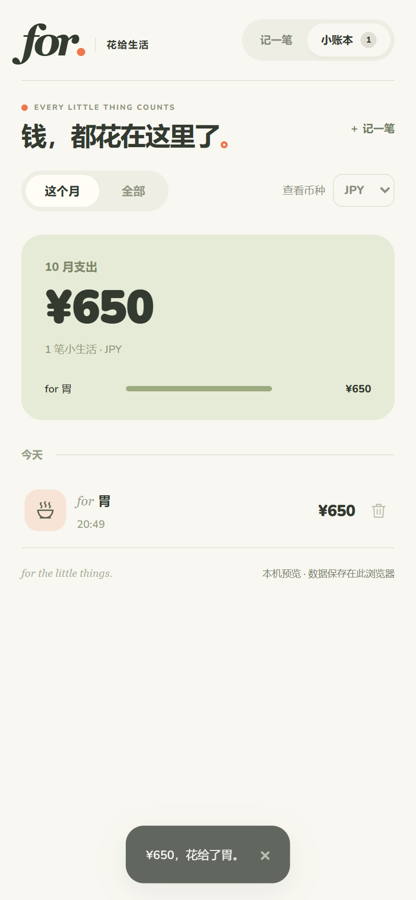
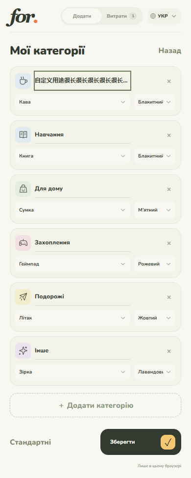
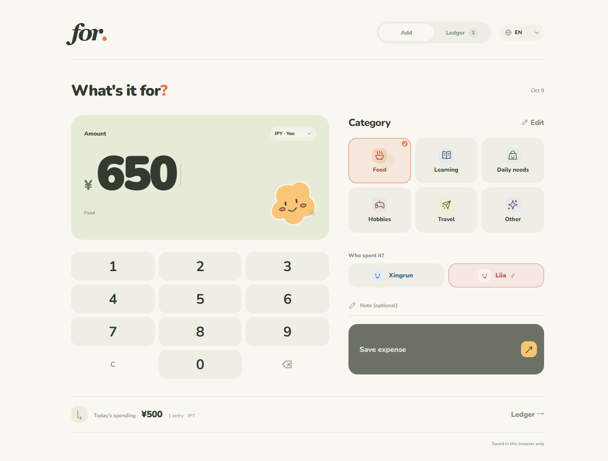
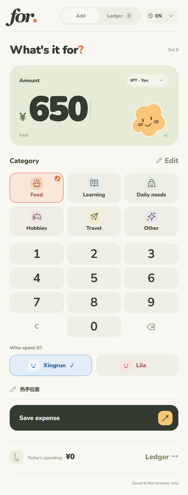
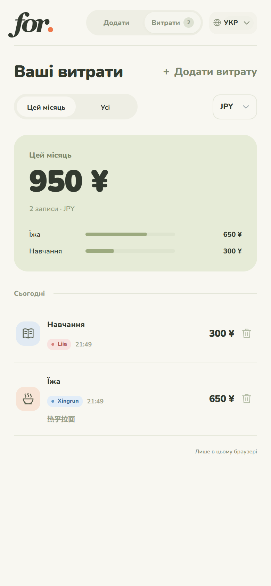

# for. · 花给生活

一个有 Q 弹手感的 Telegram 记账 Mini App。默认 **日元 JPY**。

打开 → 大数字输入金额 → 选「胃 / 学习 / 日常用品 / 兴趣 / 旅游 / 其他」→ 选 Xingrun 或 Liia → 记下。

## 界面预览

| 手机端主页 | 账本明细与汇总 | 分类编辑 |
| :---: | :---: | :---: |
|  |  |  |

| 宽屏桌面端适配 | 英文模式 | 乌克兰语模式 |
| :---: | :---: | :---: |
|  |  |  |

## 已实现

- React 18 + Vite + TelegramUI 真实组件，保留奶油色、鼠尾草绿与小表情主题。
- 金额大屏、触摸数字键盘、轻压回弹、保存反馈。
- 中文 / English / Українська 三语切换，语言偏好会保存。按钮、默认分类、账本、提示及日期 / 金额格式跟随语言；自定义分类名与备注保留原文。
- 入账前必选消费者：蓝色 **Xingrun**、红色 **Liia**。账单显示对应姓名与颜色；每次保存后清除人选，旧记录显示「未标注」。
- 界面只保留必要文字，移除装饰性英文小字和重复提示。
- JPY 整数；CNY / USD 两位小数。金额用最小单位整数存储。
- 自定义 1–18 个分类，每个名称最多 24 个字符，支持改名、选择图标和颜色、增删。历史记录保留记录时的分类名称。
- 可选备注、今日总额、月度 / 全部账本、用途汇总、按币种查看。
- 删除记录后可撤销；没有演示数据混进账本。
- 手机 / 桌面布局，键盘输入，减少动态效果设置。
- Telegram 触感反馈、展开窗口、返回按钮、有未保存输入时的关闭提示。
- 服务端验证 Telegram initData，按用户分开存储，原子写入，保存重试不重复入账。

## 本机体验

需要 Node.js 22.12 或更新版本。首次安装依赖后启动；`npm start` 会先构建 React 页面。

```powershell
cd "这里填 for-pocket 文件夹的路径"
npm ci
npm start
```

打开 <http://127.0.0.1:8787>。

开发时先运行 `npm start` 提供 API，再在另一个终端运行 `npm run dev`，打开 Vite 提示的地址（默认 5173），可热更新组件与样式。

没有配置 BOT_TOKEN 时是 **本机预览模式**：记录仅存在当前浏览器 localStorage，界面底部会说明。换浏览器、清除站点数据后不会保留，也不会自动迁入 Telegram 账本。

## 接到自己的 Telegram bot

1. 在 [@BotFather](https://t.me/BotFather) 用 `/newbot` 创建自己的 bot，取得 token。
2. 将 `.env.example` 复制为 `.env`，在本机填入 `BOT_TOKEN` 和 `PUBLIC_URL`。token 仅在服务端使用，不写进前端、不提交进 git。
3. 将整个项目放到支持 Node.js 的服务器上，执行 `npm ci` 并让 `npm start` 持续运行。外部入口必须是可访问的 **HTTPS**，代理到服务的 8787 端口。使用容器或平台分配端口时设置 `HOST=0.0.0.0` 和平台要求的 `PORT`。
4. 在另一个终端运行 `npm run bot`。它会为此 bot 设置菜单入口，并用 long polling 响应私聊 `/start` 和 `/help`。只运行一个 bot 轮询进程。
5. 私聊 bot 发送 `/start`，点「打开小账本」。也可用聊天菜单「＋ 记一笔」打开。

可选：在 BotFather 的 Bot Settings 中配置 Main Mini App，即可使用 bot 资料页入口。

`bot.mjs` 检测到已有 webhook 时会停止，防止覆盖这个 bot 的现有服务。新建一个专用 bot 最简单。

### 数据与部署

- 默认存储在 `data/<Telegram 用户 ID>.json`，服务端只允许访问已验证身份的个人账本。
- `DATA_DIR` 可设置为持久磁盘目录。**部署到容器 / 平台时需挂载持久磁盘，并定期备份**。
- 当前适用于个人小工具、单个服务进程。不要让多个服务副本同时写同一数据目录；规模扩大时应迁移到数据库。
- 默认会话有效期 24 小时；过期后从 bot 重新打开。可通过 `AUTH_MAX_AGE_SECONDS` 修改。
- 每个用户账本上限 10000 笔，包括软删除记录。删除通过标记实现，支持撤销。
- 本地预览可独立体验；真实 Telegram 入口尚需你自己的 bot token 和 HTTPS 部署地址。

## 验证

```powershell
npm test
```

测试包含身份伪造 / 过期拒绝、用户隔离、并发保存、重试去重、中文备注、分类历史保留、消费者必填验证、语言保存、删除撤销和服务重启持久化。

浏览器交互验证记录见 `VERIFICATION.md`。

## 动效设计

TelegramUI 的 `AppRoot`、`SegmentedControl`、`Button`、`Input`、`Select`、`Cell`、`Snackbar`、`Placeholder`、`Tappable` 已用于实际页面，基础样式在 `src/main.jsx` 引入；用 `--tgui--*` 主题变量延续原配色。iOS / macOS 使用 iOS 平台样式，其他客户端使用基础样式。

顶部滑动指示块约 200ms，页面短距离过渡 220ms，按压 100ms、释放 240ms。CSS transform / opacity 与 Web Animations API 承担动画，不依靠 React 逐帧更新布局。高频金额输入的伸缩幅度很小；键盘操作即时响应，系统开启减少动态效果时取消伸缩与滑入。

设计面向高刷新率屏幕，实际帧率取决于设备和 Telegram WebView；本次桌面验证不等于所有手机均已达到 120fps。

## 文件

- `src/App.jsx`：React 页面与 TelegramUI 组件。
- `src/styles.css`：原主题与组件样式适配、动效、手机布局。
- `src/services.mjs`：本地 / Telegram 服务端存储，兼容原账本数据。
- `src/icons.jsx`：分类图标与小表情。
- `index.html`、`vite.config.mjs`：React 构建入口和开发服务配置。
- `dist/`：构建产物，由 `server.mjs` 提供预览与部署页面。
- `public/shared.mjs`：前后端共用的金额、分类、消费者与验证规则。
- `public/i18n.mjs`：中文、英文、乌克兰语文案；默认分类随语言显示。
- `server.mjs`：网页服务和私人账本 API。
- `auth.mjs`：Telegram 身份验证。
- `bot.mjs`：Telegram 菜单和 `/start` 入口。
- `tests/`：关键数据完整性测试。

官方文档：[TelegramUI](https://github.com/telegram-mini-apps-dev/TelegramUI)、[Telegram Mini Apps](https://core.telegram.org/bots/webapps)、[initData 验证](https://core.telegram.org/bots/webapps#validating-data-received-via-the-mini-app)、[Bot API](https://core.telegram.org/bots/api)。
