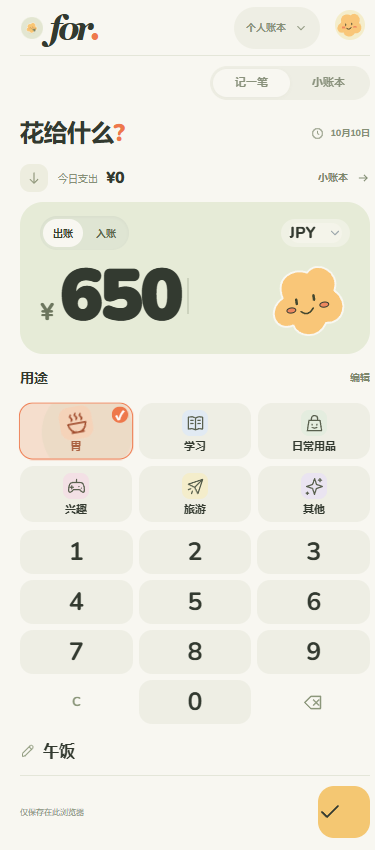
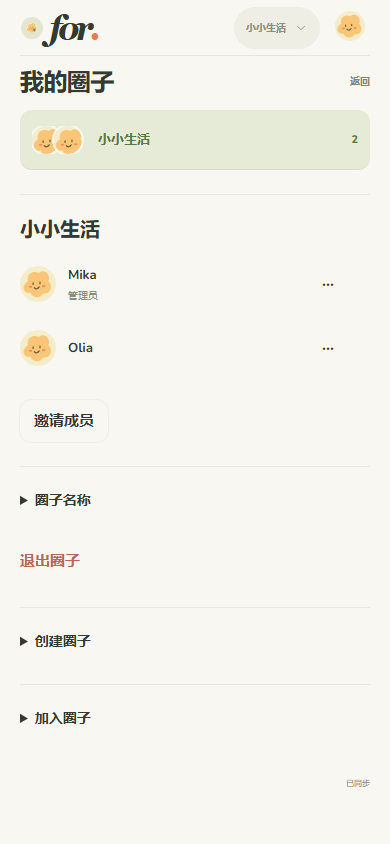

# for. · 花给生活

一个打开就能记账的 Telegram Mini App。默认日元 JPY，支持中文、English、Українська。

**输入金额 → 选用途 → 保存。** 个人账本自动记给自己；圈子可选择真实成员。昵称、头像和颜色在设置中修改。

## 界面与功能

保留奶油纸色、鼠尾草绿、小黄云和轻压回弹。金额、分类、键盘是首页主体。顶部仅保留账本切换与头像入口；圈子、账号连携、语言和个人形象放在二级页面。

| 快速记账 | 圈子管理 |
| --- | --- |
|  |  |

- 支出与收入各有独立的 1–18 个可编辑分类；流水显示正负金额、成员及分类快照，汇总显示收入、支出、结余。
- 点击首页右侧日期可选择记账时间，默认使用保存时的现在；点击旧账单时间可修改日期和时间，流水和统计随之归组。
- Google 与 Telegram 登录映射到统一账户；连携前预览、确认，合并个人记录、分类及圈子关系。
- 圈子邀请码有效期 72 小时，先预览再接受，个人账本与各圈子独立。
- 成员均可邀请；管理员可改名、移除成员、设置其他管理员；最后一位管理员退出会自动交接。每圈最多 99 名成员。
- 固定 Liia / Xingrun 角色已移除；原账单中的历史名字保留。
- 前台每 3 秒刷新共享账本，回到页面也会刷新。切换账本保留各自草稿；过期账本请求会被服务端拒绝。
- 删除及撤销、键盘输入、Telegram 触感反馈和返回按钮、减少动态效果支持。
- 小黄云图标、有效 Web App Manifest、180px iOS 主屏图标；没有离线写入同步队列。

详细差异见 [升级记录](docs/UPGRADE-v0.5.md)。

## 本机运行

需要 Node.js 22.12+。

```powershell
npm ci
npm start
```

打开 http://127.0.0.1:8787/ 。`npm start` 自动构建页面。开发时保持 API 服务运行，再执行 `npm run dev` 使用 Vite 热更新。

未登录时可直接在浏览器中记账，记录仅保存在当前浏览器。登录后打开服务器账本；原本机记录仍保留，退出登录后可查看。连携合并的是已验证的 Google / Telegram 账户，不会自动上传浏览器预览记录。

## Telegram 接入

1. 在 [BotFather](https://t.me/BotFather) 创建 bot。
2. 复制 `.env.example` 为 `.env`，设置 `BOT_TOKEN`、`PUBLIC_URL`。
3. 在可提供 HTTPS 的 Node 服务上执行 `npm ci`、`npm start`。平台需要时设置 `HOST=0.0.0.0` 和 `PORT`。
4. 单独运行 `npm run bot` 设置菜单入口并响应 `/start`。同一个 bot 只运行一个轮询进程。

`bot.mjs` 检测到已有 webhook 会停止，避免覆盖已有服务。网页服务器启动时不会自动修改 Telegram 菜单或 Telegram webhook；上线后在私有环境运行一次 `npm run bot:configure -- --apply`，脚本只会接管空 webhook 或已经指向本服务 `/api/telegram/webhook` 的 webhook。若发现其他地址会安全停止。`TELEGRAM_WEBHOOK_SECRET` 留空时，服务端和配置脚本会从 `BOT_TOKEN` 派生同一个随机不可读的校验值。

## AI 解析 API

AI 解析使用 Google Cloud Vertex AI Gemini。服务端从 Application Default Credentials 取得凭据，不把密钥发到浏览器。文字记账、普通截图、月报和图片“重试”统一使用 `gemini-3.1-flash-lite`，按标准价 $0.25 / 百万输入、$1.50 / 百万输出计费；重试只是再次识别，不会自动切换到更贵模型。可用 `VERTEX_PROJECT_ID`（或 `GOOGLE_CLOUD_PROJECT`）、`VERTEX_LOCATION`、`VERTEX_TEXT_MODEL`、`VERTEX_VISION_MODEL`、`VERTEX_SUMMARY_MODEL` 和 `VERTEX_ENHANCED_MODEL` 覆盖默认值；未配置项目或服务账号没有 Vertex AI User 权限时接口返回 `errorAiUnavailable`。

公开的 `POST /api/ai/parse-expense` 需要已有网页会话（`Authorization: Bearer <sessionToken>`，或新鲜的 `X-Telegram-Init-Data`）。JSON 请求可以传 `{ "text": "今天午饭拉面 1200 日元", "timezone": "Asia/Tokyo" }`；也可以直接上传 `image/jpeg`、`image/png`、`image/webp` 或 `image/gif` 原始图片流。响应为 `{ "items": [...] }`，每项含 `amountMinor`、`amount`、`currency`、`type`、`categoryId`、`categoryLabel`、`merchant`、`note`、`rawText`、`occurredAt`、`dayKey`、`timezone`、`confidence`、`consumer` 和分摊字段。图片只在请求期间送入模型，服务器不会持久化图片。图片缺少日期时会要求在预览中确认当前时间；解析结果始终先进入可编辑预览，用户确认后才批量保存。

历史页的 AI 小结按周或月手动生成。服务器先按当前账本、币种、时区计算总额、成员和用途聚合，只把这些聚合发送给模型，不发送备注或小票原文。月报服务与文字记账共用 `gemini-3.1-flash-lite`，没有记录、未登录或模型暂时不可用时仍显示本地统计。

`POST /api/expenses/import` 用单次事务保存 1–50 条预览记录：重复 ID、无效分摊或任一条失败会整批回滚；重复提交同一 ID 是幂等的。

供独立 Telegram bot 使用的 `POST /api/ai/telegram-parse` 不使用网页会话，而要求 `X-Bot-Token: <BOT_TOKEN>`。JSON 请求示例：

```json
{
  "telegramUserId": "123",
  "text": "今天午饭拉面 1200 日元",
  "image": { "mimeType": "image/jpeg", "data": "<base64>" }
}
```

也可以发送原始图片流，并设置 `Content-Type: image/jpeg`、`X-Telegram-User-Id: 123` 和可选的 `X-Timezone: Asia/Tokyo`。该路由会按 Telegram 身份读取个人分类，响应 `{ "userId": "u_123", "items": [...], "saved": false }`；目前只解析，不自动写入账本，调用方应让用户确认后再调用普通记账接口。限制请求大小和频率，绝不在客户端或聊天中放置 bot token。

## Google 登录与连携

在 Google Cloud 创建 **Web application** OAuth Client，将站点 origin（含协议与端口）添加到 Authorized JavaScript origins，在服务端配置 `GOOGLE_CLIENT_ID` 后重启。正式站点使用 HTTPS。

前端使用 Google Identity Services；服务端使用 `google-auth-library.verifyIdToken` 检查签名、audience、issuer、有效期，以 `sub` 识别账号。不会接受仅含 email / sub 的自报身份。会话令牌只在服务端保存哈希，退出会撤销当前会话。

Telegram 用户可直接连接 Google；也可在一端生成 15 分钟有效的连携码，在另一个已登录账号输入、预览并确认。只连接自己的账号。两个不同的同类身份会拒绝合并；同名分类采用目标配置，不同分类合并后超过 18 个会提示先精简。语言、币种及形象采用目标账号设置。

## 数据与迁移

- 新数据写入 `DATA_DIR/_pocket-v2.json`，包含用户、身份、会话、圈子及账本。事务以临时文件原子替换，合并与权限变更一起提交。
- 首次运行读取旧用户 JSON、`_shares.json`，迁移实际用户、账单、圈子及双人账本；旧文件不修改，可用于恢复。旧会话作废，需要重新登录。
- 旧双人账本变为共享圈子，原始个人记录保留。历史消费者与分类快照保留，不再作为固定角色选项。
- 部署需为 `DATA_DIR` 挂载持久磁盘并做备份。适合**单个 Node 进程**；多个副本需先改用共享数据库及事务。
- 每本账最多 10,000 条记录（含软删除）。金额按最小货币单位整数保存；JPY 整数，CNY / USD 两位小数。

## 验证与动效

```powershell
npm run build
npm test
```

[验证记录](VERIFICATION.md) 包含 API、浏览器多用户、三语、窄屏、草稿及连携检查。

React 18 + Vite，实际使用 TelegramUI 的 AppRoot、Button、Input、Select、Cell、SegmentedControl、Snackbar、Placeholder、Tappable；基础样式在 `src/main.jsx` 引入，主题变量延续原配色。

页面切换约 220ms，按压约 100ms、释放约 240ms。transform / opacity 与 Web Animations API 驱动，不通过 React 逐帧更新布局。减少动态效果时取消伸缩、滑入。实际帧率取决于设备和 Telegram WebView，未声称所有手机达到 120fps。

## 主要文件

- `src/App.jsx`：快速记账、流水、设置入口与草稿。
- `src/AccountViews.jsx`：个人形象、账号连携、圈子及对话框。
- `src/TimeEditor.jsx`：轻量日期时间编辑。
- `src/services.mjs`：本机与服务器服务。
- `src/styles.css`、`src/account-styles.css`：主题、布局与动效。
- `domain.mjs`：圈子权限、账本与账户合并。
- `store.mjs`：事务写入与数据迁移。
- `server.mjs`、`auth.mjs`：静态服务、Google / Telegram 身份验证。
- `public/shared.mjs`：共用验证；`public/i18n.mjs`、`public/account-i18n.mjs`：三语。
- `bot.mjs`：Telegram 菜单及 `/start`。

官方资料：[TelegramUI](https://github.com/telegram-mini-apps-dev/TelegramUI)、[Telegram Mini Apps](https://core.telegram.org/bots/webapps)、[Google ID token 验证](https://developers.google.com/identity/gsi/web/guides/verify-google-id-token)。

## Google Cloud 与本地目录

项目已完整迁到 **D:\Projects\Tools\for-pocket**。正式平台为 Google Cloud Run：
[生产站点](https://for-pocket-698348906987.asia-northeast1.run.app)。线上 Google/Telegram 配置已存在，真实 OAuth 验收仍需实际账号。

记账页按 Telegram 实际可用高度适配，一屏显示金额、用途、数字键和成员选择；确认键为 44×44px 小方格。“记一笔 / 小账本”固定在底部并预留安全区。较矮屏幕将分类和数字键并排排列。圈子名称可由管理员点击直接编辑；分类图标按钮展开图标与颜色选项。界面改动通过本地验证后，推送 main 会由 Cloud Build 自动发布到 Cloud Run。

金额卡片的小云朵可点击：闭眼笑、害羞、疑惑、叹气、小生气、暴怒，再轻轻炸开；「止まれ」路牌从屏幕顶部落下。点路牌两次或第七次点击后等待七秒恢复。彩蛋始终播放完整动效。

Dockerfile 提供生产构建；私有 .env、数据、备份、work 和 outputs 均不进入 Docker 镜像构建上下文或 Git。Render 工具已归档，不再参与发布。

```powershell
cd D:\Projects\Tools\for-pocket
npm run backup
npm run restore -- BACKUP_DIRECTORY EMPTY_DATA_DIRECTORY
npm run bot:configure
npm run verify:deployment -- --require-google --require-telegram
```

Cloud Run 的 /data 必须另行配置持久存储；单纯创建目录不会保留重启后的账单。详见 [当前交接说明](DEPLOYMENT_HANDOFF_PLAN.md)。
