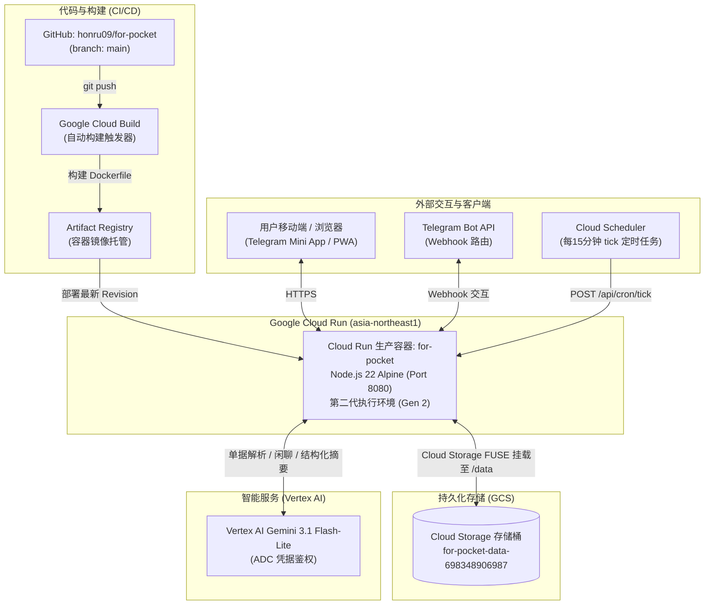

# for. Pocket · Google Cloud 部署与云基础设施全景指南

> **适用对象**：后续接手本项目的所有 AI Agent 与开发运维工程师。  
> **核心目标**：5 秒内清晰掌握本项目在 Google Cloud 上的完整拓扑、持久化挂载、IAM 权限、CI/CD 流程及环境配置，无需从零逆向推导。

---

## 1. 核心基础设施速查表 (At a Glance)

| 资源 / 属性 | 线上实际配置 | 说明与规范 |
| :--- | :--- | :--- |
| **GCP 项目编号** | `698348906987` | Google Cloud 平台 Project Number |
| **生产访问地址** | `https://for-pocket-698348906987.asia-northeast1.run.app` | Cloud Run 默认生产域名，已开启 HTTPS |
| **服务名 / 区域** | `for-pocket` / `asia-northeast1` | 日本东京区域，兼顾低延迟与合规 |
| **部署运行时** | Google Cloud Run (第二代执行环境 Gen 2) | Gen 2 必须开启，以支持 Cloud Storage FUSE 卷挂载 |
| **持久化存储** | GCS 存储桶：`for-pocket-data-698348906987` | 挂载路径：`/data`（容器内），持久化账本 `_pocket-v2.json` |
| **运行服务账号** | `698348906987-compute@developer.gserviceaccount.com` | Cloud Run 运行时使用的默认计算服务账号 |
| **AI 模型引擎** | Vertex AI (`gemini-3.1-flash-lite`) | 多模态账单、图片、语音、文档识别与生活账本闲聊 |
| **CI/CD 流水线** | Google Cloud Build 触发器 | 监听 GitHub `honru09/for-pocket` 的 `main` 分支 push 自动发布 |
| **定时调度** | Cloud Scheduler (`*/15 * * * *`) | 触发 `POST /api/cron/tick` 执行时区分流日报与未记账提醒 |

---

## 2. 架构拓扑与数据流向



---

## 3. 数据持久化方案（关键澄清）

> [!IMPORTANT]
> **历史文档纠偏**：早期草案及迁移快照（如 `DEPLOYMENT_HANDOFF_PLAN.md` 2026-10-10 版）中曾标记“容器停止后未挂载外部存储的数据会消失；当前持久方案尚未核实”。**现已完全核实并上线稳定方案**，请任何后续接手人员以此处为准：

1. **存储桶配置**：
   - 存储桶名称：`for-pocket-data-698348906987`
   - 存储级别：Standard
   - 位置：`asia-northeast1`（与 Cloud Run 处于同一机房，零跨区流量延迟）
2. **挂载方式**：
   - 使用 Cloud Run 原生 **Cloud Storage 卷挂载（Cloud Storage FUSE）**。
   - 容器内挂载点：`/data`。
   - 运行时要求：Cloud Run 服务配置中**必须启用“第二代执行环境 (Execution Environment: Second Generation)”**，因为第一代 gVisor 沙箱无法支持 FUSE 用户态文件系统。
3. **数据文件组织**：
   - 生产主数据文件：`/data/_pocket-v2.json`。
   - 备份目录：`/data/backups/`（可通过 `npm run backup` 触发）。
4. **实例伸缩与防并发写入**：
   - Cloud Run 设置：`min-instances = 1`（维持热机常驻容器，杜绝冷启动及单进程内存态震荡）。
   - `max-instances = 10`。
   - 写入机制：系统通过 `store.mjs` 实现原子临时文件重命名写入（`rename` 原子操作），保证写入 GCS 时的完整性。

---

## 4. 身份与 IAM 权限配置

Cloud Run 容器由默认服务账号驱动，无需在代码内硬编码服务密钥，全流程基于 GCP Application Default Credentials (ADC)：

- **服务账号 (Service Account)**：  
  `698348906987-compute@developer.gserviceaccount.com`
- **必须赋予的 IAM 角色**：
  1. **Storage Object Admin (`roles/storage.objectAdmin`)**：  
     用于 Cloud Storage FUSE 挂载读写存储桶 `for-pocket-data-698348906987`。
  2. **Vertex AI User (`roles/aiplatform.user`)**：  
     用于 Node 服务调用 Vertex AI SDK (`@google-cloud/vertexai`) 访问 Gemini 3.1 Flash-Lite 模型。
  3. **Artifact Registry Writer (`roles/artifactregistry.writer`)**：  
     用于 Cloud Build 构建镜像并推送到项目的容器镜像库。

---

## 5. 环境变量与 Secret 清单

Cloud Run 生产环境变量配置（脱敏说明）：

| 变量名 | 默认 / 生产值 | 说明 |
| :--- | :--- | :--- |
| `NODE_ENV` | `production` | 生产模式 |
| `PORT` | `8080` | Cloud Run 容器监听端口（容器启动自动注入） |
| `HOST` | `0.0.0.0` | 监听所有网络接口 |
| `DATA_DIR` | `/data` | 对应 GCS FUSE 挂载的本地目录 |
| `PUBLIC_URL` | `https://for-pocket-698348906987.asia-northeast1.run.app` | 生产公开 URL，供 Telegram Webhook 和 OAuth 校验回调 |
| `BOT_TOKEN` | *[Secret]* | Telegram Bot 访问令牌（保存在 Secret Manager） |
| `TELEGRAM_WEBHOOK_SECRET` | *[Secret]* | Telegram Webhook 回调安全标头校验令牌 |
| `GOOGLE_CLIENT_ID` | `698348906987-7gpleqigrc2u7bce3r9m5mkuertn68hb...` | Google OAuth Web 客户端 ID（公开 Client ID） |
| `CRON_SECRET` | *[Secret]* | 定时任务标头 `X-Cron-Secret` 密钥 |
| `VERTEX_PROJECT_ID` | `698348906987` | Vertex AI 所属 GCP 项目编号 |
| `VERTEX_LOCATION` | `asia-northeast1`（或 `global`） | Vertex AI 模型调用区域 |
| `VERTEX_TEXT_MODEL` | `gemini-3.1-flash-lite` | 文本解析与对话模型 |
| `VERTEX_VISION_MODEL` | `gemini-3.1-flash-lite` | 单据、票据与图片识别模型 |
| `STORE_ASYNC_PERSIST` | `false` | Cloud Run 上请求结束后 CPU 可能被限流，设为 false 保证请求内完成刷盘 |

---

## 6. 持续集成与发布 (CI/CD)

- **代码仓库**：`https://github.com/honru09/for-pocket.git`
- **核心分支**：`main`
- **自动触发**：Cloud Build 触发器绑定此分支。
- **发布操作流程**：
  ```powershell
  # 1. 本地完成开发与回归测试
  npm test
  npm run build

  # 2. 提交并推送到 GitHub main
  git add .
  git commit -m "feat/fix: <说明>"
  git push origin main
  ```
- **构建生命周期**：
  1. Cloud Build 检测到 commit，执行多阶段 Docker 构建（`Dockerfile`）。
  2. 构建完成后将镜像推送至 Artifact Registry。
  3. Cloud Run 部署新 Revision，平滑转移 100% 流量至新实例。

---

## 7. Cloud Scheduler 定时任务配置

为支撑分时区日报（10:00、13:00、20:00）及夜间（22:00）未记账提醒，配置了 Cloud Scheduler 任务：

- **调度频率**：`*/15 * * * *`（每 15 分钟执行一次，确保跨时区边缘无漏发）
- **请求方法**：`POST`
- **目标 URL**：`https://for-pocket-698348906987.asia-northeast1.run.app/api/cron/tick`
- **请求标头**：
  - `Content-Type: application/json`
  - `X-Cron-Secret: <CRON_SECRET_VALUE>`
- **请求体 (Body)**：`{}`
- **特性**：接口内部根据账本所属时区计算幂等槽位（`morning` / `noon` / `evening` / `reminder`），同一账本在同一天的同一时段仅触发一次，不产生重复通知。

---

## 8. 运维与验证指令 (Verification)

接手的 AI Agent 可随时通过以下命令验证线上部署与健康情况：

### 8.1 自动化验证脚本
```powershell
# 验证线上 Cloud Run 状态（包含版本、Google 配置、Telegram 配置、资源完整性）
node scripts/verify-deployment.mjs https://for-pocket-698348906987.asia-northeast1.run.app --require-google --require-telegram
```

### 8.2 手动 HTTP 快速探针
```powershell
# 1. 健康检查端点
curl -s https://for-pocket-698348906987.asia-northeast1.run.app/health
# 返回格式示例: {"ok":true,"version":"0.5.0","commit":null,"revision":"for-pocket-00064-7cn"}

# 2. 配置与特性就绪检查
curl -s https://for-pocket-698348906987.asia-northeast1.run.app/api/config
# 返回格式示例: {"version":"0.5.0","mode":"remote","googleClientId":"...","telegramEnabled":true,"aiEnabled":true}
```

---

> [!TIP]
> **交接准则**：在修改任何涉及存储、鉴权或 Vertex AI 调用的逻辑前，请务必核对本指南中的环境变量与服务权限要求，切勿在 Git 提交中包含私有密钥文件或破坏 `/data` 挂载路径。
