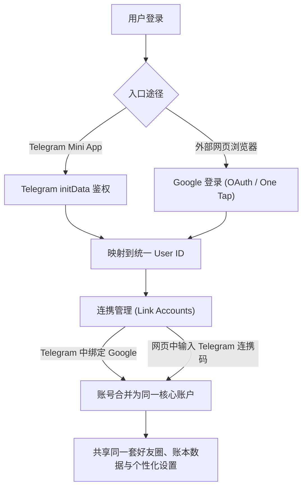

# for. Pocket 全面升级方案：桌面图标、Google+Telegram双登录连携、好友圈(Life360模式)与出入账功能

## 一、方案概览

根据用户提出的需求，本次升级将对系统架构、认证体系、社交圈模型和记账核心流程进行深度扩展：

1. **网站 Logo 与 iOS 桌面图标 (PWA / Touch Icon)**：
   - 将用户上传的可爱黄色云朵小钱夹吉祥物图作为网站 Logo、浏览器 Favicon、iOS 桌面图标（`apple-touch-icon`）及 Web App Manifest 图标。
   - 当在 iOS Safari 中点击“添加到主屏幕”时，桌面上将呈现该图标。
2. **Google 登录与 Telegram 多端连携 (Dual Auth & Cross-Platform Linking)**：
   - **网页端与 Mini App 数据共通**：支持 Google 登录与 Telegram 登录两种途径。
   - **互通连携机制**：在 Telegram 中可一键连携 Google；在普通浏览器中用 Google 登录后，也可输入 6 位连携码绑定 Telegram。
   - 绑定后两端账号映射至同一统一账户，数据完全共通、实时同步。
3. **好友与好友圈系统 (Life360 模式，人数上限 4 人)**：
   - **先成为好友**：每位用户拥有专属好友码，支持输入好友码添加双向好友。
   - **再创建好友圈**：从好友列表中勾选成员组建好友圈（包含圈主在内上限 4 人）。
   - **圈子协同记账**：进入圈子后，记账角色选择器动态展示圈内成员（最多 4 人），记录出账/入账圈内所有人实时共享。
4. **出账 / 入账（支出 / 收入）功能**：
   - 在录入界面金额/价格区域旁加入温润的“出账 / 入账”双模式切换按键。
   - 切换为“入账”时金额前置“+”号、自动切换为专属收入分类（工资、奖金、兼职、红包、报销、理财、其它等）。
   - 流水列表与汇总条同步清晰展示“出账”、“入账”与“结余”。
5. **视觉与动效风格保证**：
   - 严格沿用现有的日式纸质温润美学、Liia 奶白色调、可爱萌宠手绘图标与柔和物理弹跳微动效。

---

## 二、架构设计与核心逻辑

### 1. 账号与认证模型 (Unified Auth & Linking)

- **数据存储 (`_shares.json` / `_auth.json`)**：
  - `accounts`: `{ "telegram:12345": "u_001", "google:sub_6789": "u_001" }`
  - `userProfiles`: `{ [userId]: { name, avatar, color, friendCode, tgUser, googleEmail } }`
  - `sessions`: `{ [token]: { userId, expiresAt } }`
  - `linkCodes`: `{ [code]: { userId, expiresAt } }` (6位临时连携码，有效15分钟)

### 2. 好友与好友圈模型 (Friends & Circles, Max 4 People)
- **好友关系 (`friends`)**：
  - 每个用户拥有唯一的 6 位“好友码”（如 `FR-K7M8Q2`）。
  - 输入对方好友码即建立好友关系。
- **好友圈关系 (`circles`)**：
  - 创建圈子：指定圈子名称（如“双人小窝”、“四人合租记账”）。
  - 邀请逻辑：**必须先在好友列表中**，方可邀请加入圈子（严格遵循 Life360 逻辑）。
  - 成员上限：1～4 人（包含创建者）。
  - 每个圈子绑定一个共享账本 ID（`circleLedgerId`）。进入圈子后，记账页面即为圈子公共账本，选择成员时展示圈内 2～4 名好友。

### 3. 出账 / 入账双模记账模型 (Expense / Income)
- **记录结构 (`Expense`)**：
  - 新增字段 `type: 'expense' | 'income'`（缺省为 `'expense'`，100% 向下兼容）。
- **交互设计**：
  - 在录入页面上方或金额卡片内，放置 `[ 出账 ]` 与 `[ 入账 ]` 两个可爱的胶囊按键。
  - 选“出账”：显示支出分类（热乎饭、咖啡、日常用品、学习、旅游等），金额为支出。
  - 选“入账”：显示收入分类（工资、奖金、兼职、红包、报销、投资、其他等），金额高亮温润薄荷绿（`#5a8c62`）。
- **统计展示**：
  - 今日汇总栏：展示今日出账、今日入账及结余净额。
  - 账本流水：出账为深色/纸墨色，入账显示为带 `+` 绿色徽标。

---

## 三、文件修改计划

### 1. 静态资源与 PWA 桌面图标
- `public/logo.jpg`、`public/apple-touch-icon.png`：复制用户上传的吉祥物图片。
- `public/manifest.webmanifest`：配置 Web App 清单文件（名称、启动路径、桌面图标尺寸、背景色）。
- `index.html`：增加 `apple-touch-icon`、`favicon`、`manifest` 及 Google Identity Services 脚本支持。

### 2. 基础公共库与多语言
- `public/shared.mjs`：
  - 增加收入分类常量 `DEFAULT_INCOME_CATEGORIES` 与图标定义。
  - 扩展 `validateExpense` 支持 `type: 'expense' | 'income'`。
  - 增加圈子与好友数据校验函数。
- `public/i18n.mjs`：
  - 增加中、英、乌克兰语词条：出账、入账、今日入账、今日结余、Google 登录、连携账号、好友码、添加好友、好友列表、创建好友圈、圈子成员（上限4人）、收入分类名称等。
- `src/icons.jsx`：
  - 增加收入分类手绘 SVG 图标：钱袋（wallet）、硬币（coins）、礼物（gift）、发票（receipt）、存钱罐（piggybank）、银行卡（card）、转账（transfer）。
  - 增加 Google 图标与好友/圈子图标。

### 3. 服务端认证与业务逻辑 (`server.mjs`)
- **多端鉴权与会话管理**：
  - 支持 `x-telegram-init-data` 与 `Authorization: Bearer <sessionToken>` 统一解析。
  - 增加 `POST /api/auth/google`：支持 Google 登录验证并颁发 Session Token。
  - 增加 `POST /api/auth/link-code` 与 `POST /api/auth/link-verify`：生成与核验 6 位账号连携码，将 Google 与 Telegram 账号关联到同一用户。
- **好友与圈子接口**：
  - `GET /api/social`：获取当前用户的好友列表与所属好友圈。
  - `POST /api/friends/add`：通过好友码添加好友。
  - `POST /api/circles/create`：创建好友圈（校验成员来自好友列表，且总人数 ≤ 4）。
  - `POST /api/circles/switch`：切换当前活动圈子。
- **出账/入账统一存储**：
  - `POST /api/expenses` 支持接收 `type: 'expense' | 'income'` 并写入账本。

### 4. 前端接口层 (`src/services.mjs`)
- 扩展 `remoteService` 与 `localService`，增加 Google 登录、连携账号、好友添加、圈子创建与出入账支持。

### 5. 界面与交互层 (`src/App.jsx` & `src/styles.css`)
- **导航与顶部**：
  - 品牌处展示可爱的黄色钱夹云朵吉祥物 Logo。
  - 新增“好友圈”视图/浮层入口（可在右上角或管理页中直达）。
- **记账主界面**：
  - 金额区域加入单纯温润的 `出账 / 入账` 切换按钮。
  - 根据模式平滑过渡切换支出分类或收入分类。
  - 成员选择器支持展示当前圈子成员（最多 4 人）。
- **管理与好友圈界面**：
  - 账号连携卡片：清晰显示已绑定的 Google 与 Telegram 账号状态及连携操作。
  - 好友卡片：展示专属好友码、添加好友输入框及好友列表。
  - 好友圈卡片：展示当前圈子（成员头像与名字，上限 4 人）或从好友中勾选创建新圈子。
- **账本流水与统计**：
  - 今日汇总条与历史页支持出账、入账与结余多维统计展示。

---

## 四、验证计划

### 1. 自动化测试 (`tests/`)
- 运行 `npm test`：
  - 验证 Telegram initData 与 Google Session 认证。
  - 验证 Telegram 账号与 Google 账号的连携合并。
  - 验证好友添加与好友圈创建（最多 4 人约束校验）。
  - 验证出账与入账的存储、计算与结余汇总。

### 2. 构建与运行验证
- 运行 `npm run build` 确保 Vite 打包产物无编译错误。
- 启动本地服务器验证 Web 端 Google 登录与连携、iOS 桌面图标与出入账切换。
- 推送至 GitHub `main` 分支触发 Render 线上自动部署并验证。
