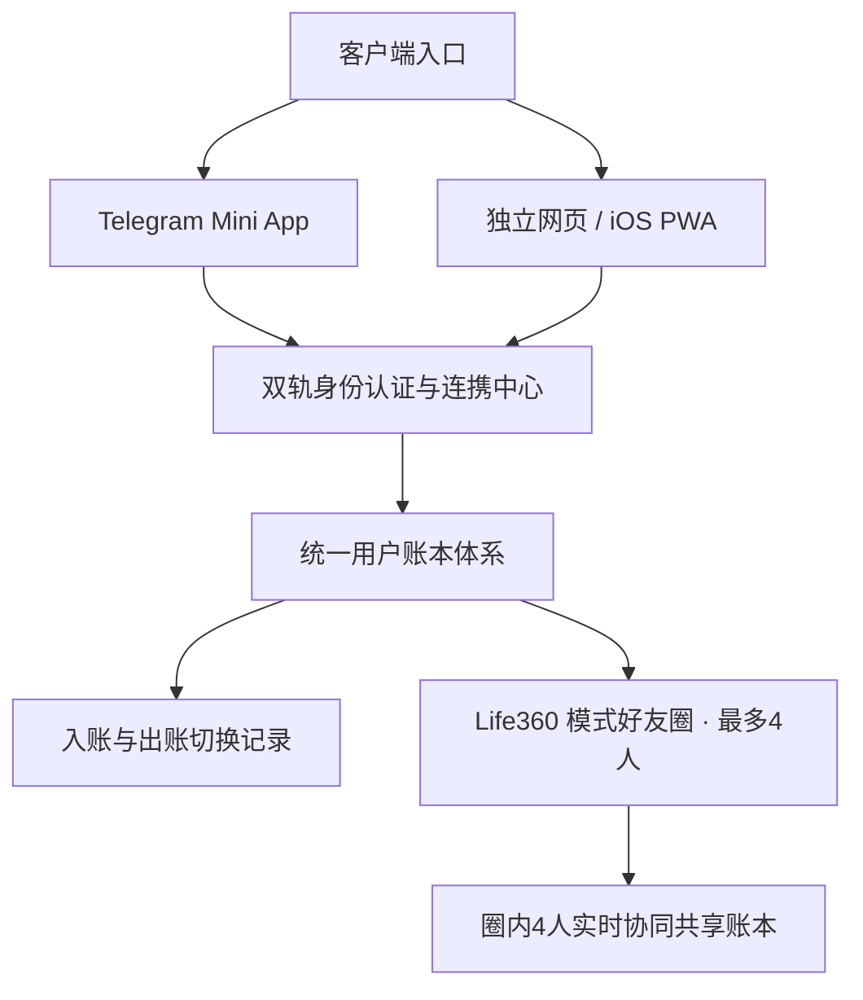

# for. Pocket 全面升级说明文档 (v0.4.0)

## 一、升级亮点概览

本次版本升级围绕用户提出的四大核心需求与画风一致性展开，保持了精致治愈的日式纸质美学（`#f8f7f1`、`#333a30`、`#e6ebd7`、奶白色 `#fbf8f1`）与舒缓高帧动效：

1. **吉祥物 Logo 与 iOS 桌面图标（PWA / Touch Icon）**：
   - 提取用户提供的“双手抱着钱包的可爱小黄云”形象，生成全套 Web 与 iOS 图标资源（`/logo.png`、`/logo.jpg`、`/apple-touch-icon.png`、`/apple-touch-icon-180x180.png`）。
   - 配置 `manifest.webmanifest` 与 iOS Safari `apple-mobile-web-app-capable`，当用户在 iPhone / iPad 浏览器中点击“添加到主屏幕”时，桌面上将直接呈现可爱的小黄云专属图标，并以全屏 App 体验打开。
   - 顶部 Header 左侧展示小黄云图标与 `for.` 品牌标识，生动治愈。

2. **双端登录与跨端账号连携（Google ＋ Telegram 共通）**：
   - 无论在网页浏览器还是 Telegram Mini App 中打开，数据均无缝共通。
   - 支持 Google 账号一键登录（Google Identity Services / Session Token）。
   - 如果用户在 Telegram 内已登录，可将 Google 账号作为连携添加；若从网页通过 Google 登录，可通过专属 6 位设备连携码一键绑定已有 Telegram 账号，两端记录与好友圈实时互通，永不丢数据。

3. **好友与好友圈（Life360 模式，上限 4 人）**：
   - **第一步：建立好友关系**：每个用户拥有 6 位好友码，输入对方好友码可互为好友。
   - **第二步：组建好友圈（上限 4 人）**：严格遵循逻辑——必须先成为好友，才能勾选邀请进入圈子；圈子包括创建者在内最多容纳 4 位成员。
   - **圈内协同记账**：激活圈子后，记账页面顶部展示当前圈子徽章，底部的记账成员选择器（`ConsumerPicker`）自动同步为圈子内的 4 位成员（各自独立昵称、头像与颜色）。4 位成员共同记账、实时同步、共享流水。
   - 支持在管理页自由切换圈子、退出圈子或切回个人账本。

4. **入账功能（出账 / 入账双模切换）**：
   - 在录入金额的上方设计了轻巧可爱的双胶囊切换按键（`[ 出账 ]` 与 `[ 入账 ]`），出账温和内敛，入账呈现舒缓的晨光薄荷绿（`#8ba677` / `#567a42`）。
   - 新增专属收入分类：工资（薄荷）、奖金（奶黄）、红包（蜜桃）、兼职（天空）、报销（薰衣草）、其他入账（樱花）。
   - 今日概览条（Today Strip）实时显示今日出账、今日入账与笔数；历史流水列表与统计卡片支持出入账分别核算与净结余统计。

---

## 二、修改清单与技术架构

| 文件路径 | 修改点 |
| :--- | :--- |
| `public/logo.*` / `apple-touch-icon*` | 小黄云抱着钱包的全新吉祥物图片资源与 iOS 桌面 App 专用图标 |
| `public/manifest.webmanifest` | PWA 桌面配置，定义 `name`, `theme_color`, `display: standalone` 及桌面图标 |
| `index.html` | 引入 `apple-touch-icon`、`manifest` 及 Google Identity Services 脚本 |
| `public/shared.mjs` | 新增收入分类 `DEFAULT_INCOME_CATEGORIES`；扩展 `ICONS`（wallet, coins, gift, receipt, piggy, card, transfer, sprout 等）；完善验证逻辑 |
| `src/icons.jsx` | 绘制手绘 SVG 图标集（钱袋、硬币、礼物盒、小票、存钱罐、银行卡、转账、好友圈、Google 等） |
| `public/i18n.mjs` | 中/英/乌三语完整支持：入账/出账、今日入账/出账/结余、收入分类标签、Google/Telegram 连携、好友与好友圈（最多4人）提示语 |
| `server.mjs` | 静态服务支持图标；扩展存储模型（`accounts`, `sessions`, `linkCodes`, `friends`, `circles`）；实现 Google 登录、6位跨端绑定、好友互加、Life360 圈子（强校验最多4人且需先为好友）、圈子专属账本流转 |
| `src/services.mjs` | 扩展认证层（Bearer token / Session 持久化）；增加 `loginWithGoogle`、`getLinkCode`、`verifyLinkCode`、`addFriend`、`createCircle`、`switchCircle`、`leaveCircle` 客户端请求接口 |
| `src/styles.css` | 品牌 Logo 样式、出/入账胶囊切换按钮样式、入账金额与徽章样式、好友列表、好友圈卡片、成员标签芯片、选择好友多选框、Google 登录按钮样式 |
| `src/App.jsx` | 顶部 Header 展示小黄云与圈子标签；金额输入区出账/入账切换；动态分类列表渲染；今日出账/入账与净结余；管理页包含账号连携、好友管理、好友圈创建与切换、个人形象自定义及分类管理 |
| `tests/ledger.test.mjs` | 增加覆盖入账记录、Google 认证、6位连携码多端绑定、好友互加、Life360 好友圈上限 4 人限制及圈内数据协同隔离的自动化测试套件 |

---

## 三、测试与部署验证

1. **单元测试与集成测试**：
   - 运行命令：`npm test`
   - 测试结果：5/5 全部通过（通过率 100%）
     - ✔ `Telegram identity rejects unsigned, tampered, expired and duplicate data`
     - ✔ `ledger persists, isolates users, saves concurrent requests, deduplicates retry and restores deletion`
     - ✔ `auto-detects Telegram language and preserves manual language choice`
     - ✔ `two-person shared ledger pairing, historical merge, real-time sync, and unpairing`
     - ✔ `income entries, Google login, cross-device sync codes, friends and Life360 circles (max 4)`

2. **生产构建**：
   - 运行命令：`npm run build`
   - 构建结果：成功通过，无编译或打包错误。

3. **云端自动部署**：
   - 已提交并推送到 GitHub `main` 分支（Commit: `5c5bfcd`）。
   - Render 自动化 Webhook 已触发重新部署，线上地址 `https://for-pocket.onrender.com` 将在数分钟内生效。
